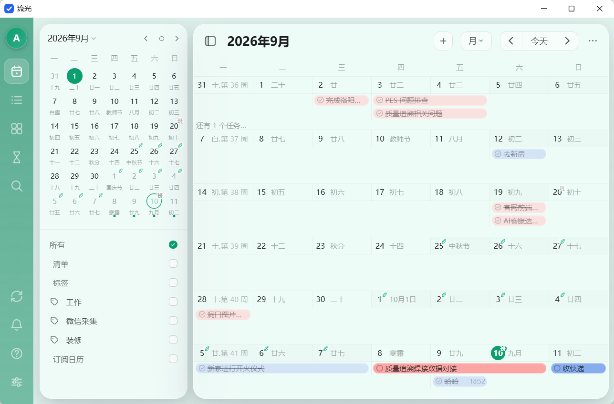
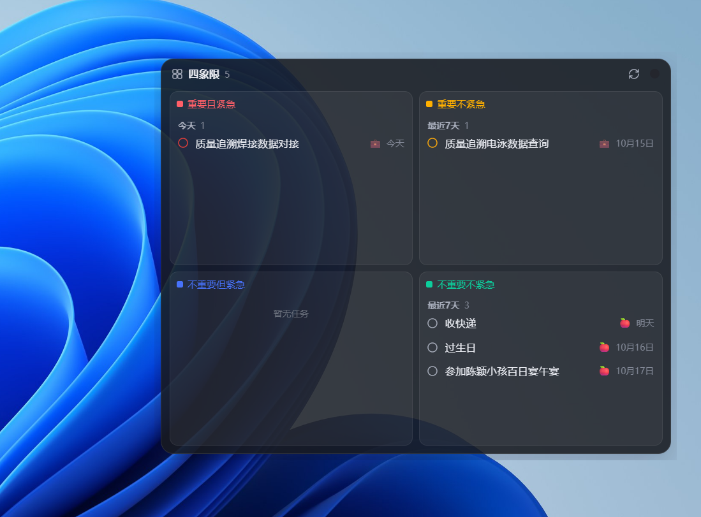

# 流光 LIUG

> 全程 vibecoding 的产物，感谢 **TRAE、GLM-5.3、DEEPSEEK-V4** 对本项目的大力支持
> 功能设计参考 **滴答清单**
> 前端设计使用了 **Skills For Designers and Engineers**  [github.com/emilkowalski/skills.git](https://github.com/emilkowalski/skills.git)

自托管的日程管理应用：以月/周日历为核心，任务清单、四象限、倒数日一站式管理；玻璃质感 UI（主色 #484553、灰阶 rgba(25,25,25,x)、背景照片、48 个 SVG 图标）。

- **前后端分离**：前端 Vue 3 + Vite，后端 Python FastAPI + SQLite（多用户，每人独立数据库文件）
- **可纯浏览器使用**：一个命令启动服务，访问 `http://localhost:4300` 即可
- **Windows 桌面版**：打包为单个 `liug.exe`（系统托盘常驻 + 主界面 + 桌面四象限小组件）





## 一、功能特性

### 主应用（浏览器）

| 模块   | 说明                                                                       |
| ------ | -------------------------------------------------------------------------- |
| 任务   | 清单列表视图：按清单筛选、显示已完成、过期红字                             |
| 日历   | 本应用核心：月/周视图、迷你月历（农历/节气/法定节假日图标）、清单/标签筛选 |
| 四象限 | 艾森豪威尔矩阵（重要×紧急），任务可跨象限拖拽（自动改写优先级与截止日期） |
| 倒数日 | 纪念日/倒数日/生日/节日卡片，支持农历与每年重复，预置 8 个节日             |
| 搜索   | Ctrl+K 全局搜索标题/备注/标签                                              |
| 设置   | 主题颜色自定义（8 预设 + 自定义取色器），即时生效并持久化                  |
| 账户   | 多用户登录（scrypt 密码哈希 + HMAC 签名 Cookie 会话），每人数据独立库隔离  |

### 月/周视图细节

- 月视图：6×7 网格、任务色块（清单色半透明，完成后淡化+删除线）、格子容量自适应（「还有 N 个任务…」浮层）、双击空白格快速添加、拖拽任务改期
- 周视图：7 列 + 全天任务区 + 24 小时时间网格、定时任务按时段定位、当前时间红线
- 任务详情就地弹层（点击位置旁弹出）：日期/时间/全天、重复规则、优先级、清单、标签、Markdown 备注、子任务
- 外部清单应用 CSV 备份导入：清单(emoji)、文件夹、标签、起止时间(时区换算)、优先级、状态、子任务全量口径

### Windows 桌面版（liug.exe）

- 单进程 = 系统托盘（pystray）+ 主界面窗口（pywebview/WebView2）+ 可选桌面小组件 + 内嵌 uvicorn 服务
- 单实例互斥锁防双开；主窗口点 × 隐藏到托盘，托盘「退出」才结束
- 内嵌服务使用粘性动态端口（上次端口 → 4300 → 随机，bind 即占有并记录到 `data/service-port.json`），不与其他程序冲突；数据与日志在 exe 同级 `data/`
- **离线可用 + 云端同步**：登录云端账号后数据保存在本地镜像库，断网照常使用，联网后自动与服务器双向同步（也可在设置面板手动「立即同步」）
- 登录持久化（WebView2 非隐私模式），重启 exe 免登录

### 桌面四象限小组件

- 无边框透明窗口常驻桌面（主应用 `/quadrant` 页面）：标题栏拖动、边缘/四角拖拽缩放（420×320 ~ 1100×900）、−/＋按钮与 Ctrl+滚轮缩放
- 图钉置顶切换、玻璃白/主题色/暗色三档配色、位置/尺寸/置顶记忆（`data/widget.json`）
- 与主界面窗口通过 storage 事件实时双向同步；未登录时显示提示卡可一键唤起主窗口登录

### 管理端（/admin/，仅管理员）

- 独立的用户管理控制台：新增用户、启用/禁用、重置密码、切换管理员/普通角色、删除用户
- 双重防线：IP 白名单（`LIUG_ADMIN_ALLOWED_IPS`，默认仅本机）+ 独立登录页校验管理员角色，白名单外连页面都打不开（403），不影响主应用
- 复用主应用会话体系（同一 Cookie 与密钥）；重置密码后目标用户全部会话即时失效
- 保护规则：不能对自己禁用/降级/删除，系统至少保留一个可用管理员；删除用户保留其数据文件
- 独立前端工程 `admin_client/`，不打包进桌面 exe（详见「快速开始 · 管理端」）

## 二、技术栈

| 层        | 技术                                                     |
| --------- | -------------------------------------------------------- |
| 前端      | Vue 3.5`<script setup>`、Vite 6                        |
| 后端      | Python FastAPI + uvicorn + SQLite（WAL、软删除）         |
| 农历/节日 | lunar-javascript（农历/节气/传统节日）+ 内置法定节假日   |
| 桌面壳    | pywebview（WebView2）+ pystray（托盘）+ PyInstaller 打包 |
| 图标      | 内置 48 个 SVG symbol（雪碧图，`<use>` 引用）          |

## 三、快速开始

### 环境要求

- Windows（桌面版功能仅限 Windows；纯浏览器模式其他平台也可跑）
- Python ≥ 3.10（开发环境为 3.13）
- Node.js ≥ 18（Vite 6 要求）

### 1. 安装依赖

```powershell
# 远程后端依赖（fastapi / uvicorn / httpx / regex）
pip install -r server/requirements.txt

# 前端依赖（主应用）
npm install --prefix client

# 管理端前端依赖（可选，需要用户管理功能时安装）
npm install --prefix admin_client
```

### 2. 构建前端

```powershell
npm run build --prefix client       # 产出 client/dist/（主应用）
npm run build --prefix admin_client # 产出 admin_client/dist/（管理端，可选）
```

### 3. 启动服务

```powershell
python server/app.py               # 或 npm run server --prefix client
```

打开 [http://localhost:4300](http://localhost:4300)。首次启动自动完成数据库初始化（无需手动建库）：自动创建 `data/` 目录、用户主库 `data/users.db`、会话密钥 `data/users.db.secret` 与默认管理员的独立数据库，并创建默认管理员：

- 账号 `admin` / 密码 `admin123`（请尽快修改密码）

后端同时提供 API 并托管 `client/dist` 静态站点，**日常使用只需这一个进程**。

### 开发模式（改前端代码时用，热更新）

```powershell
python server/app.py               # 终端 1：后端
npm run dev --prefix client        # 终端 2：开发服务器 http://localhost:5180（/api 代理到 4300）
```

### 管理端（用户管理，可选）

管理端是独立的用户管理控制台，部署在服务器上供管理员使用（桌面 exe 不包含）：

```powershell
npm run build --prefix admin_client   # 需先 npm install --prefix admin_client
```

- 访问 `http://<host>:4300/admin/`，用管理员账号（默认 `admin`）登录；未构建前端时返回 404 提示
- 开发模式：`npm run dev --prefix admin_client`（[http://localhost:5181](http://localhost:5181)，`/admin` 代理到 4300）
- IP 白名单：环境变量 `LIUG_ADMIN_ALLOWED_IPS`（逗号分隔，支持 IP / CIDR / `*`，默认 `127.0.0.1,::1` 仅本机）；若需局域网管理，例如：

```powershell
$env:LIUG_ADMIN_ALLOWED_IPS='127.0.0.1,::1,192.168.1.0/24'; python server/app.py
```

- 静态资源目录可用 `LIUG_ADMIN_DIST_DIR` 覆盖（默认 `admin_client/dist`）

### 导入外部清单应用 CSV 备份（可选）

页面内导入（推荐）：日历右上「更多 ⋮」→「导入 CSV 备份…」。

```powershell
# 或 CLI（目标库由 LIUG_DB_PATH 指定）
python core/import_csv.py <备份.csv>
```

## 四、桌面版与打包 exe（Windows）

桌面客户端支持两种使用方式：**单机模式**（免登录——数据仅保存在本机 `<LIUG_USERS_DIR>/local.db`
单文件，不同步任何服务器，点一次「单机使用」后跨重启免登录）与**云端账号**（登录页「登录账号
（云端同步）」填写服务器地址与账号密码，由本地服务代理登录；数据保存在本地镜像库
`<LIUG_USERS_DIR>/<远程用户ID>.db`，**断网照常使用**，联网后自动与服务器双向同步——上传本地
改动、拉取远端更新，设置面板可查看同步状态并手动「立即同步」；两种模式的数据完全隔离）；
桌面端**不含用户管理逻辑**（多用户账户体系仅存在于 `server/` 远程后端，不打包进 exe）。

### 源码运行桌面版

```powershell
pip install -r desktop/requirements.txt    # 含 pywebview / pystray / pillow
python desktop/main.py                     # 需先执行过 npm run build --prefix client
```

### 打包成单个 liug.exe

```powershell
pip install pyinstaller
npm run build --prefix client                  # 确保前端构建产物是最新的
python -m PyInstaller --noconfirm liug.spec
# 产物：dist/liug.exe（单文件、无控制台窗口，双击即用）
```

- 已打包 `client/dist` 静态资源与全部运行时依赖；数据目录在 exe 同级 `data/`，与源码运行的 `data/` 互不干扰
- 排查 exe 问题先看 `data/desktop.log` 与 `data/desktop.err.log`
- 注意：spec 会从 conda Python 的 `Library/bin` 收集 OpenSSL/libffi/sqlite3 等运行时 DLL，换 Python 环境构建时需确认该目录仍存在
- 升级替换 exe 前，请先从托盘图标右键「退出」旧实例（单实例互斥锁会阻止双开）

### 独立小组件（可选）

`desktop/desktop_widget.py`：只启动四象限小组件的轻量入口（优先复用已运行的 4300 主服务，否则内嵌独立服务）：

```powershell
python desktop/desktop_widget.py    # 需先执行过 npm run build --prefix client
```

## 五、测试环境（数据隔离）

所有测试必须使用独立测试库，**不得触碰正式数据**（`data/users.db`、`data/users/`）：

```powershell
# 测试服务器（端口 4301，首次启动自动创建测试管理员 admin / admin123）
$env:LIUG_USERS_DB_PATH='data/users.test.db'; $env:LIUG_USERS_DIR='data/users-test'; $env:PORT='4301'; python server/app.py
# 访问 http://localhost:4301（管理端测试：http://localhost:4301/admin/）

# 测试库导入外部清单 CSV
$env:LIUG_DB_PATH='data/schedule.test.db'; python server/import_csv.py <csv路径>
```

用完清掉环境变量（`Remove-Item Env:LIUG_USERS_DB_PATH` 等）或直接关闭该终端，避免误连测试库。

## 六、数据说明

- **多用户隔离**：`data/users.db` 为账户主库（scrypt 密码哈希）；每个用户的数据在 `data/users/<用户唯一ID>.db` 独立 SQLite 文件中
- `data/schedule.db` 为旧单用户版真实数据，已被只读迁移为 admin 账户的独立库，原文件保留不动
- 会话：HMAC 签名 Cookie（`liug_session`），密钥存 `data/users.db.secret`，有效期 7 天

## 七、目录结构


```
liug/
├── liug.spec                # PyInstaller 打包配置（桌面版整应用，入口 desktop/main.py）
├── run.md                   # 详细启动/运维指南
├── core/                    # 业务核心（远程后端与桌面客户端共享）
│   ├── app_factory.py       # FastAPI 组装工厂（业务路由 + 认证路由 + 静态托管）
│   ├── routes.py            # /api/* 业务路由（鉴权依赖注入；含 /api/sync 同步端点）
│   ├── sync.py              # 同步核心：快照构建 / LWW 合并 / 幂等应用
│   ├── auth.py              # scrypt 密码 / HMAC 会话纯函数
│   ├── db.py                # 每用户 SQLite 建表与数据访问（guid/触发器/墓碑）
│   ├── import_csv.py        # 外部清单 CSV 备份导入（CLI / API）
│   ├── holidays.py          # 法定节假日
│   └── errors.py            # 统一错误 {"error": 中文}
├── server/                  # 远程后端（唯一保留用户管理的地方）
│   ├── app.py               # 入口：组装 core + 账户体系 + 管理端路由 + 托管 client/dist
│   ├── users.py             # 多用户账户体系（登录/会话/用户库隔离）
│   ├── routes_auth.py       # 认证路由（login/logout/me/change-password）
│   ├── routes_admin.py      # 管理端路由（/admin API + IP 白名单 + admin_client/dist 托管）
│   └── requirements.txt
├── desktop/                 # 桌面客户端（不含用户管理，账户体系不进 exe）
│   ├── main.py              # 桌面版整应用（托盘+主窗+小组件+内嵌服务，粘性动态端口）
│   ├── local_auth.py        # 本地认证（单机免登录 + 云端账号代理登录，同 Cookie 契约）
│   ├── sync.py              # 云端同步引擎（防抖/定时/手动同步 + 状态接口）
│   ├── desktop_widget.py    # 独立四象限小组件启动器
│   ├── widget_window.py     # 小组件窗口 Win32 拖动/缩放辅助
│   ├── assets/liug.ico
│   └── requirements.txt
├── client/                  # Vue3 + Vite 前端
    └── src/
        ├── App.vue          # 布局壳（背景/弹层/快捷键）
        ├── store.js         # 全局响应式状态 + 任务操作 + 主题色
        ├── api.js           # REST 封装
        ├── lib/             # lunar.js（农历/节日）、countdown.js（倒数日）
        ├── styles/          # global.css（玻璃风格变量）
        └── components/      # 日历/四象限/倒数日等页面组件
            ├── CalendarPage.vue、MonthView.vue、WeekView.vue、MiniCalendar.vue
            ├── MatrixPage.vue（四象限）、FocusPage.vue、CountdownPage.vue、ListPage.vue
            ├── QuadrantWidget.vue（桌面小组件页面）
            └── MarkdownEditor.vue、DatePicker.vue、GlassSelect.vue（通用组件）
└── admin_client/            # 管理端独立前端（Vue3 + Vite，不打包进 exe）
    └── src/
        ├── App.vue          # 会话探测 → 登录页 / 用户控制台
        ├── api.js           # /admin REST 封装
        ├── style.css        # 玻璃风格变量
        └── components/      # AdminLogin.vue、UsersConsole.vue、GlassModal.vue
```

## 八、常见问题

- **端口被占用**：`netstat -ano | findstr 4300` 找到 PID，确认是旧服务后 `taskkill /PID <pid> /F`
- **桌面 exe 双击没反应**：先确认托盘没有旧实例（互斥锁单实例）；再看 exe 同级 `data/desktop.err.log`
- **前端改了代码桌面版没变化**：桌面窗口的 WebView2 有持久缓存，本项目已用「URL 版本号 + no-cache」根治；若仍旧，退出 exe 后删除 `%APPDATA%\pywebview` 缓存目录再启动
